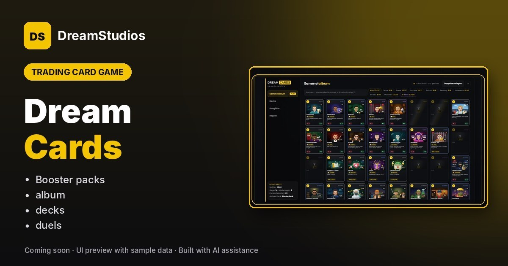
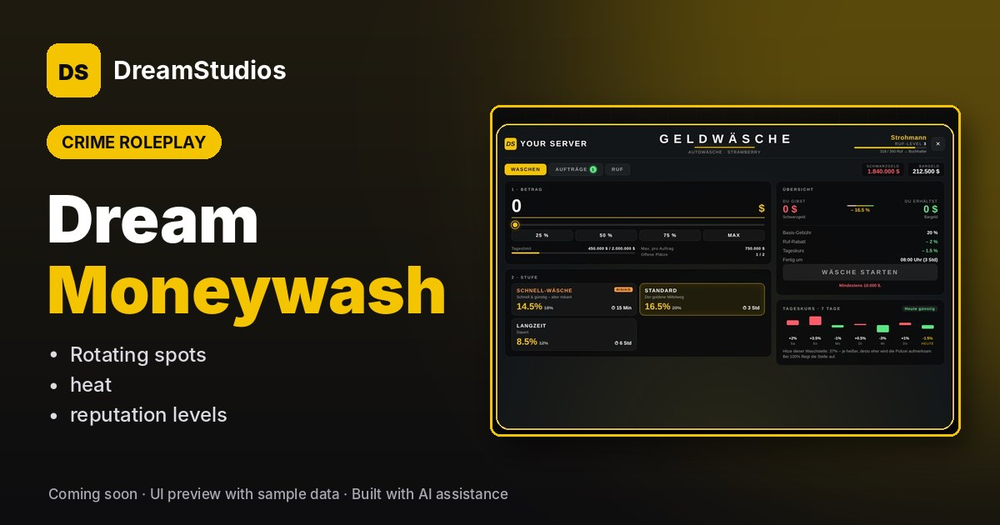
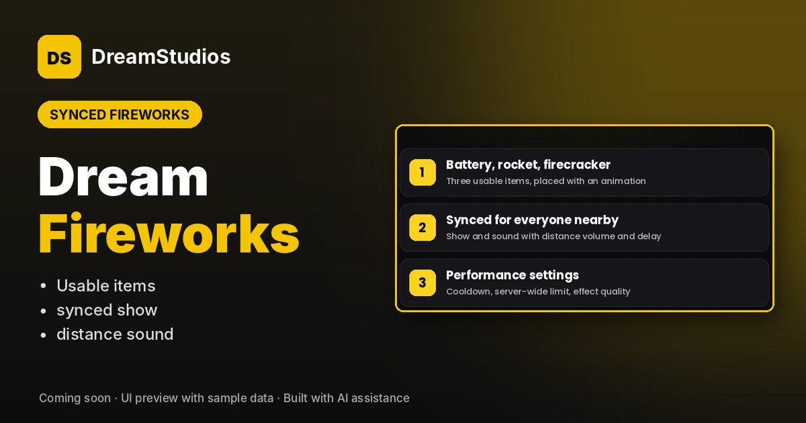

# DreamScripts by DreamStudios

**Lua scripts for ESX roleplay servers – with their own interfaces, open configuration and server-side checks.**
One script is free with full source code. Seven premium scripts are in their final checks.

  

> This repository is a **catalog**. The free script lives in [dream_notify](https://github.com/datenhaus/dream_notify). Premium scripts will be sold in our store (opening soon). All images show a UI preview with sample data.

---

## Free now

### Dream Notify
Notifications and announcements for your roleplay server. Four toast types, six screen positions, a queue, 23 built-in icons, an `/announce` banner with permission check and cooldown. English and German included. No database, full source code.

**→ [Download Dream Notify](https://github.com/datenhaus/dream_notify)**

---

## Coming soon

| | |
|---|---|
|  |  |
|  |  |
|  |  |
|  | |

### Dream Cards
A trading card game for your city: booster packs, an album, decks, duels and holo cards.

### Dream Adminjail
Admin jail with a clean panel, time presets, reason templates, a live countdown and searchable logs.

### Dream Billing
Job and private invoices with late fees and an overview for bosses.

### Dream Moneywash
Rotating wash spots with heat and reputation levels, made for crime roleplay.

### Dream Elevator
Elevators and vehicle lifts with a floor panel, set up with an in-game editor.

### Dream Fireworks
Synced fireworks as usable items, with sound that depends on distance.

### Dream Scoreboard
A city overview: players online, jobs on duty and the next restart.

---

## What every script has
- English and German included
- Settings in `config.lua`, no hidden values
- Server-side checks for anything that matters
- Automated code checks and UI previews before every release

## Questions, ideas, bug reports
Join the [Discord](https://discord.gg/2cAK4XMzSe). Want to know when the store opens? The announcement comes there first.

---
Made by [DreamStudios](https://github.com/datenhaus) – one human sets the direction, a team of AI agents builds. Built with AI assistance.
