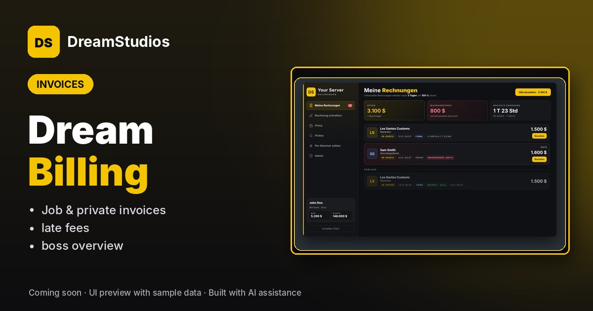
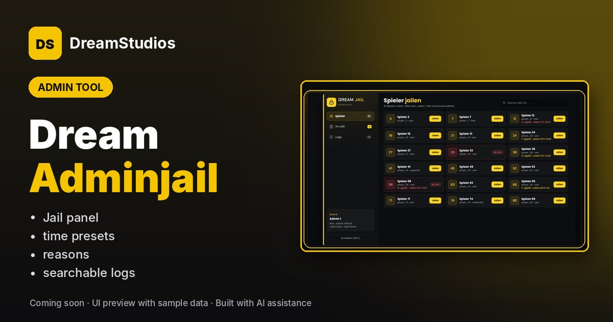
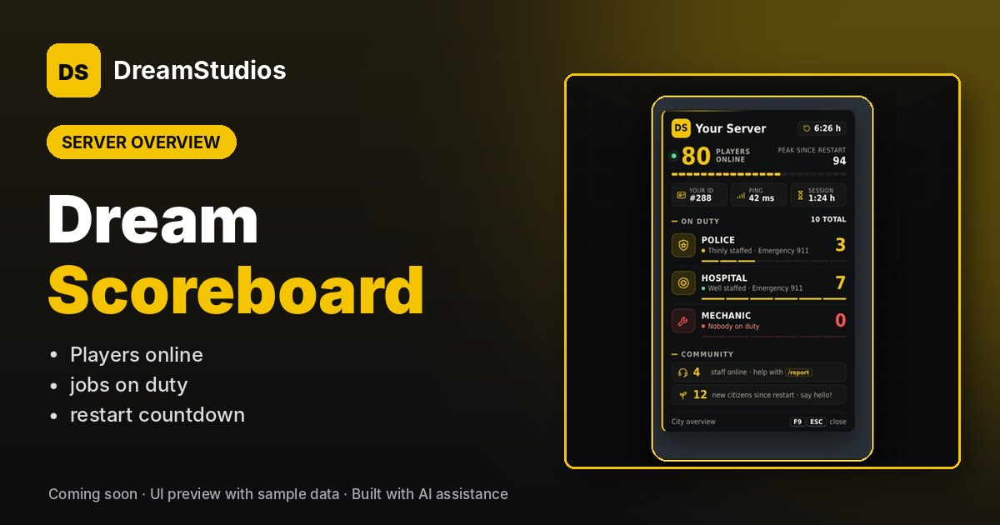
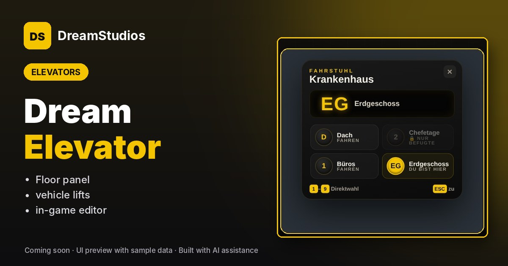

# DreamScripts by DreamStudios

**Lua scripts for roleplay servers – with their own interfaces, open configuration and server-side checks.**
Six premium scripts are on Tebex, two more follow on Tue 17 Nov. One script stays free with full source code.

  

> This repository is a **catalog**. The free script lives in [dream_notify](https://github.com/datenhaus/dream_notify). Premium scripts are sold on Tebex. All images show a UI preview with sample data.

**Store:** [dreamscripts.tebex.store](https://dreamscripts.tebex.store) · **Documentation:** [dreamscripts-docs](https://github.com/datenhaus/dreamscripts-docs) · [Docs website](https://datenhaus.github.io/dreamscripts-docs/)

**Launch week: -20 % until Sun 22 Nov 23:59 CET.**

**New & free:** [Dream Cards Lite](https://dreamscripts.tebex.store/package/7816915) – 20-card trading card game for ESX, tested on our live server.

**New video:** [6 scripts to level up your roleplay server](https://youtu.be/QcBy2JHxEd8)

---

## Premium – on Tebex (6 released)

| | |
|---|---|
|  |  |
|  |  |
|  |  |

| Script | Framework | Docs |
|---|---|---|
| [Dream Cards](#dream-cards) | ESX Legacy + oxmysql | [Docs](https://github.com/datenhaus/dreamscripts-docs/tree/main/dream_tcg) |
| [Dream Moneywash](#dream-moneywash) | ESX Legacy + oxmysql | [Docs](https://github.com/datenhaus/dreamscripts-docs/tree/main/dream_moneywash) |
| [Dream Billing](#dream-billing) | ESX Legacy + oxmysql | [Docs](https://github.com/datenhaus/dreamscripts-docs/tree/main/dream_billing) |
| [Dream Elevator](#dream-elevator) | ESX Legacy + oxmysql | [Docs](https://github.com/datenhaus/dreamscripts-docs/tree/main/dream_fahrstuhl) |
| [Dream Adminjail](#dream-adminjail) | ESX Legacy; Standalone, QBCore/Qbox (beta) + oxmysql | [Docs](https://github.com/datenhaus/dreamscripts-docs/tree/main/dream_adminjail) |
| [Dream Scoreboard](#dream-scoreboard) | ESX Legacy; Standalone, QBCore/Qbox (beta) | [Docs](https://github.com/datenhaus/dreamscripts-docs/tree/main/dream_scoreboard) |

Current prices are in the [store](https://dreamscripts.tebex.store).

Premium scripts are escrow-protected. `config.lua` and the locale files stay open, so you can change settings and texts.

### Dream Cards
A trading card game for your city: booster packs, an album, decks, duels and holo cards.

### Dream Billing
Job and private invoices with late fees and an overview for bosses.

### Dream Adminjail
Admin jail with a clean panel, time presets, reason templates, a live countdown and searchable logs.

### Dream Scoreboard
A city overview: players online, jobs on duty and the next restart.

### Dream Moneywash
Rotating wash spots with heat and reputation levels, made for crime roleplay.

### Dream Elevator
Elevators and vehicle lifts with a floor panel, set up with an in-game editor.

---

## Free now

### Dream Notify
Notifications and announcements for your roleplay server. Four toast types, six screen positions, a queue, 23 built-in icons, an `/announce` banner with permission check and cooldown. English and German included. No database, full source code.

**→ [Download Dream Notify](https://github.com/datenhaus/dream_notify)**

---

## Coming Tue 17 Nov

### Dream Loading
A loading screen with progress bar, tips, news / rules / team tabs and optional music. Works without any framework.

### Dream Rules
A welcome window with your server rules: scroll to the end, accept or decline, saved per player without a database. Works without any framework.

### Dream HUD, Dream Report
In the works.

---

## What every script has
- English and German included
- Settings in `config.lua`, no hidden values
- Server-side checks for anything that matters
- Automated code checks and UI previews before every release

## Questions, ideas, bug reports
Join the [Discord](https://discord.gg/XhHQkkXkFW) or follow [@zatoTVreal](https://x.com/zatoTVreal).

---
Made by [DreamStudios](https://github.com/datenhaus) – one human sets the direction, a team of AI agents builds. Built with AI assistance, tested on our live roleplay server DreamRP (ESX Legacy).
